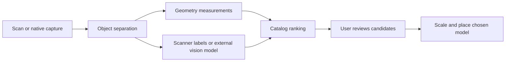

# Workspace Geometry

Measure scan objects and suggest furniture replacements without letting a language model invent dimensions.

A standalone TypeScript library for the geometry and catalog-matching stage of a room editor. It runs in Node or a browser, has no runtime dependencies, and makes **no network or AI API calls**. The examples contain synthetic geometry and illustrative vectors, not real scans or trained embeddings.

## What works today

- Normalize metre, centimetre, millimetre and foot units; convert Z-up points to right-handed Y-up coordinates.
- Estimate a yaw-oriented enclosing box from an already separated point cloud using horizontal PCA.
- Group raw points into distance-connected candidate clusters with an explicit optional floor-height hint and a work budget.
- Preserve a scanner's supplied dimensions, location and yaw when available.
- Rank up to three same-category catalog models by dimensional/proportion fit, plus cosine similarity when comparable appearance embeddings are supplied.
- Compare both 0° and 90° model orientations, reject scale factors outside 0.5–2, and flag anisotropic scaling above a 1.35 ratio.
- Return bottom-center placement transforms and require explicit candidate acceptance. Low-confidence or unknown labels return no suggestions.
- Export a studio-coordinate suggestion through `toStudioSuggestion` without modifying the source scan.

## Run

Node 22 or later is required. Installation needs npm registry access; processing is fully local.

```sh
npm ci
npm test
npm run demo
node scripts/match.mjs examples/scan.json examples/catalog.json
```

To use the library locally in a separate app, first run `npm run build`, then install this directory with `npm install /path/to/workspace-geometry`. This package is not published to npm. A deployment should vendor a reviewed build or pin a packaging release; do not rely on a developer's filesystem path in production.

```ts
import { analyze, acceptCandidate } from "@brighter-robots/workspace-geometry";
const result = analyze(scan, catalog);
// Show result.objects[i].candidates in the review UI.
// Only after the user selects one:
const placement = acceptCandidate(result.objects[0], "compact-sofa");
```

The included example returns matching sofas for a labelled sofa and no candidates for an unidentified object. Ranking scores are not recognition probabilities.

## Pipeline and boundaries



This repo implements geometry measurements, simple candidate clustering, ranking and placement. **It does not yet run a vision classifier, generate embeddings, read GLB/USDZ, or perform learned semantic instance segmentation.** Connected components alone cannot distinguish touching furniture, remove arbitrary walls, or recognize object types. Do not present them as furniture detections.

An upstream model may provide a category and image embedding. Geometry remains measured independently. Appearance comparison requires matching `embeddingSpace` identifiers and vector lengths; otherwise ranking uses category and dimensions only. The example vectors are synthetic. No model provider has been chosen or evaluated.

## Coordinate and asset contract

`src/index.ts` exports the full types and runtime validators. Scan version is `1`. Every observation has a unique ID and exactly one of `points` or `box`. Units and up-axis are mandatory. Boxes currently require Y-up; Z-up **points** are converted using `[x,z,-y]`. Catalog dimensions are always metres, ordered `[width, height, depth]`.

Canonical world coordinates are right-handed, +Y up. A box center is its geometric center, and yaw rotates about +Y in radians. Models must be normalized to bottom-center origin, with +X width and +Z depth. The returned position is the measured bottom center. Candidate yaw can add a quarter-turn to align dimensions. The scanner's axis does not necessarily identify a sofa's front: opposite-facing and symmetric objects still need user review.

PCA boxes include every supplied point; there is no silent outlier trimming. Occlusion, attached objects and outliers can make them inaccurate. Square footprints have ambiguous orientation. The classification threshold (0.6), ranking weights, scaling limits and distortion threshold are initial heuristics, not calibrated against real scans.

`fromRoomPlanBridge` accepts a small native-app bridge object with explicit dimensions, center, category, yaw and confidence. **It is not a parser for Apple's raw serialized JSON or USDZ.** A native capture exporter must extract those fields from its SDK version. See [Apple RoomPlan](https://developer.apple.com/augmented-reality/roomplan/). Native categories outside the supported set must map to `unknown`. Use declared confidence conventions rather than pretending a heuristic number is a calibrated probability.

## Website integration

Keep this package separate from the editor. The upload layer should normalize or segment the scan, then call `analyze`. Render candidate cards from the returned suggestions; do not replace the original scan. `assetId` identifies a model in the consuming application's approved catalog, not an external URL to download. The application loads that model after acceptance.

`toStudioSuggestion` maps world X/Z to the editor's X/Y ground plane. It retains yaw. The existing studio does not yet support all these rotation transforms, so the matching review UI and rotation-aware placement still need wiring before automatic matches can be applied there. This repository is independently runnable; it is not yet a deployed backend or integrated classifier.

Blender is optional for preparing normalized catalog assets. No Blender backend is required by this library.

## Validation

Synthetic tests cover unit conversion, rotated boxes, dimensional preservation, unknown labels, category filtering, appearance-space mismatch, scale constraints, placement origin, explicit acceptance, clustering budgets and the native capture bridge. They establish implementation behavior, not real-world recognition accuracy. A real-scan benchmark with reviewed labels and dimensions is the next validation step.

## Privacy and licensing

Do not commit customer scans, photos, credentials or model-provider keys. The `scans/` directory is ignored. No third-party assets or private website source are included.

A source-code reuse license has not been selected. This repository is public for review; no open-source reuse rights are granted yet. Dependency license notices remain with their dependencies.
